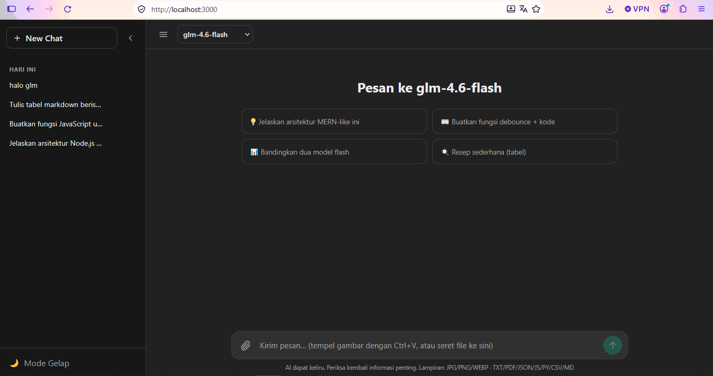

# 💬 Multi Provider Local AI Chat — Aplikasi Web Chat AI Multi-Provider

Aplikasi web chat AI modern yang menyerupai tampilan ChatGPT. Dibangun menggunakan **Vanilla HTML/CSS/JS** di sisi frontend, **Express.js** di backend, dan **SQLite** untuk penyimpanan riwayat permanen.

Mendukung respons streaming kata-per-kata (*Server-Sent Events*), berbagai penyedia model AI (**Google Gemini, Z.AI/Zhipu, OpenAI**), serta kemampuan membaca lampiran gambar dan dokumen.

---

## ✨ Fitur Utama

* **Multi-Provider AI:** Ganti model AI langsung dari dropdown (Z.AI GLM, Google Gemini, OpenAI, atau penyedia lain yang kompatibel dengan OpenAI).
* **Mode Uji Tanpa API Key (`MOCK_API`):** Coba seluruh tampilan dan fitur aplikasi secara lokal tanpa perlu mendaftar atau membayar API key.
* **Streaming Jawaban Real-Time:** Teks muncul kata demi kata dilengkapi indikator mengetik, tombol **Stop** untuk menghentikan respons, dan tombol **Regenerasi**.
* **Riwayat Chat Permanen (SQLite):** Semua percakapan tersimpan otomatis di komputer Anda (`data/app.db`). Mendukung fitur ganti judul (*rename*) dan hapus chat.
* **Input Multimodal (Gambar & Dokumen):**
  * Unggah file lewat tombol klip, *drag & drop* ke layar, atau tempel gambar langsung dari *clipboard* (`Ctrl+V`).
  * Mendukung gambar (`.jpg`, `.png`, `.webp`, `.gif`), dokumen `.pdf`, dan file teks/kode (`.txt`, `.json`, `.js`, `.py`, `.csv`, `.md`).
* **Tampilan Modern & Responsif:** Mendukung **Mode Gelap / Terang**, render tabel Markdown, *syntax highlighting* untuk kode program, serta tombol **Salin Kode**.

---

## 🖥️ Preview

<div align="center">
  
  <p><em>Tampilan AI Chat saat dijalankan</em></p>
</div>

---

## 📋 Prasyarat Sebelum Memulai

Pastikan komputer Anda sudah terpasang:
1. **Node.js** versi **18.0 atau lebih baru** ([Unduh di sini](https://nodejs.org)).
2. **Package Manager:** `npm` (sudah bawaan Node.js) atau `pnpm`.

> 💡 **Cek versi Node.js Anda** dengan membuka Terminal / Command Prompt lalu ketik:
> ```bash
> node -v
> ```

---

## 🚀 Panduan Instalasi & Menjalankan Aplikasi

Ikuti langkah-langkah berikut secara berurutan:

### 1. Unduh & Masuk ke Folder Project
Jika menggunakan Git, clone repositori ini (atau ekstrak file ZIP jika mengunduh manual):
```bash
git clone https://github.com/muhzinasrori/multi-provider-local-ai-chat.git
cd multi-provider-local-ai-chat
```

### 2. Install Dependensi
Jalankan salah satu perintah berikut di terminal:

**Menggunakan npm:**
```bash
npm install
```

**Atau menggunakan pnpm:**
```bash
pnpm install
```

### 3. Siapkan File Konfigurasi (`.env`)
Salin file contoh `.env.example` menjadi `.env`:

* **Mac / Linux / Git Bash:**
  ```bash
  cp .env.example .env
  ```
* **Windows (Command Prompt):**
  ```cmd
  copy .env.example .env
  ```

### 4. Atur API Key atau Aktifkan Mode Uji
Buka file `.env` yang baru dibuat menggunakan teks editor (VS Code, Notepad, dll), lalu pilih salah satu cara berikut:

#### Opsi A: Menggunakan Model AI Asli (Disarankan)
Isi minimal **satu** API Key penyedia AI yang Anda miliki:
```env
PORT=3000

# Isi salah satu API Key di bawah ini:
GEMINI_API_KEY=masukkan_api_key_gemini_anda_disini
ZAI_API_KEY=masukkan_api_key_zai_anda_disini
OPENAI_API_KEY=masukkan_api_key_openai_anda_disini

MOCK_API=false
```
* **Dapatkan API Key Gemini (Gratis/Berbayar):** [Google AI Studio](https://aistudio.google.com/app/api-keys)
* **Dapatkan API Key Z.AI (Zhipu):** [Z.AI Open Platform](https://z.ai/manage-apikey/apikey-list)
* **Dapatkan API Key OpenAI:** [OpenAI Platform](https://platform.openai.com/api-keys)

#### Opsi B: Mencoba Aplikasi Tanpa API Key (Mode Mock)
Jika Anda belum punya API Key dan hanya ingin melihat tampilan/cara kerja aplikasi:
```env
PORT=3000
MOCK_API=true
```

### 5. Jalankan Server
Jalankan perintah berikut di terminal:
```bash
npm start
```
*(Untuk mode development dengan auto-restart saat kode diubah, gunakan `npm run dev`)*

Jika berhasil, akan muncul pesan di terminal:
```text
✔ AI Chat berjalan di http://localhost:3000
  Provider aktif: Google Gemini (2 model)
```

### 6. Buka di Browser
Buka browser Anda (Chrome, Edge, Firefox, Safari) dan kunjungi alamat:
👉 **http://localhost:3000** *(atau sesuaikan dengan angka `PORT` di file `.env` Anda)*

---

## 🛠️ Cara Menambah Penyedia AI Lain (Opsional)

Aplikasi ini mendukung penyedia lain yang memiliki endpoint kompatibel dengan OpenAI (seperti **DeepSeek, Groq, Ollama, OpenRouter**, dll):

1. Tambahkan variabel key baru di file `.env`:
   ```env
   DEEPSEEK_API_KEY=sk-xxxxxxxxxxxx
   ```
2. Buka file `server/config.js`, lalu tambahkan objek baru ke dalam array `PROVIDERS`:
   ```js
   {
     id: 'deepseek',
     label: 'DeepSeek',
     adapter: 'openai',
     apiKeyEnv: 'DEEPSEEK_API_KEY',
     baseUrlEnv: 'DEEPSEEK_BASE_URL',
     defaultBaseUrl: 'https://deepseek.com',
     models: ['deepseek-chat'],
     vision: false,
   },
   ```
3. Restart server (`Ctrl + C` lalu jalankan `npm start` lagi). Model baru akan otomatis muncul di dropdown.

---

## 📂 Struktur Folder Project

```text
multi-provider-local-ai-chat/
├── .env                  # Konfigurasi rahasia & API key Anda (jangan dibagikan)
├── .env.example          # Template konfigurasi bawaan
├── package.json          # Daftar library & script perintah
├── data/                 # Folder database SQLite (terbuat otomatis saat dijalankan)
│   └── app.db            # Menyimpan riwayat percakapan & metadata lampiran
├── uploads/              # Menyimpan file gambar/dokumen yang diunggah pengguna
├── server/               # Kode Backend (Node.js + Express)
│   ├── index.js          # Server utama, API endpoint, & streaming SSE
│   ├── config.js         # Pengaturan port & daftar provider/model AI
│   ├── db.js             # Skema tabel & query database SQLite
│   ├── prompt.js         # Pengolah lampiran (gambar base64 & ekstraksi PDF)
│   └── adapters/         # Penghubung ke masing-masing API AI (gemini, openai, mock)
└── public/               # Kode Frontend (HTML, CSS, JavaScript)
    ├── index.html        # Halaman utama antarmuka chat
    ├── css/style.css     # Desain tema gelap/terang & responsif mobile
    └── js/app.js         # Logika interaksi UI, markdown, & pembaca stream SSE
```

---

## ❓ Pemecahan Masalah (Troubleshooting)

* **Muncul banner kuning *"Belum ada API Key aktif"* di bagian atas web:**
  Pastikan Anda sudah membuat file `.env` (bukan hanya `.env.example`), mengisi minimal satu API Key tanpa tanda kutip berlebih, lalu **me-restart server** di terminal.
* **Error saat `npm install` pada bagian `better-sqlite3`:**
  Pastikan Anda menggunakan Node.js versi 18 ke atas. Jika menggunakan `pnpm`, izinkan build script dengan menjalankan `pnpm approve-builds` atau pastikan file `pnpm-workspace.yaml` tersedia.
* **Port `3000` sudah digunakan aplikasi lain (`EADDRINUSE`):**
  Buka file `.env`, ubah baris `PORT=3000` menjadi angka lain seperti `PORT=4000`, lalu jalankan ulang server.
* **Gambar atau PDF gagal dibaca oleh model AI:**
  Pastikan model yang dipilih mendukung fitur gambar (*Vision*). Untuk file PDF, ukuran maksimal unggahan default adalah **20 MB** (bisa diubah lewat `MAX_UPLOAD_MB` di `.env`).
